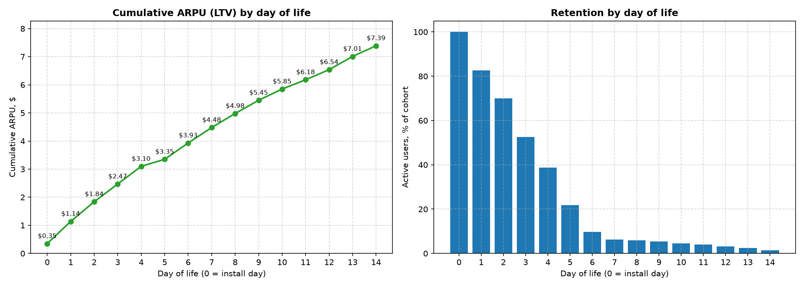

# Mobile Game Monetization Analytics

An end-to-end data pipeline and SQL analysis of in-app purchases (IAP) in a free-to-play mobile game: from raw event logs to retention, LTV, ARPU and ARPPU.



## Key results

| Metric | Value |
|---|---|
| Users / events after cleaning | 2,000 / 9,852 |
| Day 1 retention | 82.6% |
| Day 7 retention | 6.3% |
| Cumulative ARPU (LTV), day 7 | $4.48 |
| Cumulative ARPU (LTV), day 14 | $7.39 |
| Payer conversion | 7.0% |
| ARPU / ARPPU (whole period) | $7.74 / $110.58 |
| Revenue share of the two most expensive items | 90.8% |

LTV and retention are calculated on the **mature cohort** only: 1,099 users who installed at least 14 days before the end of the data.

> **The data is synthetic.** Real game revenue data is confidential, so a generator simulates player behaviour. The numbers show that the pipeline and metrics work. They are not insights about real players: segment shares and spending patterns are assumptions built into the generator.

## Pipeline

**1. Data synthesis (Python, NumPy)**
- 2,000 users in three segments: 90% F2P, 8% Dolphins, 2% Whales. Each segment has its own activity length and purchase probability.
- Events: `install`, `session_start`, `purchase` with four items from $1.99 to $99.99.
- About 1% of timestamps are set to `NaN` to imitate dirty raw logs.

**2. ETL (pandas → SQLite)**
- Drop broken rows and fill missing values.
- Normalize into two tables: `users` (cohort date = first time seen) and `events`, with a foreign key and indexes.
- Batch load with `executemany`. Tables are recreated on each run, so re-running never duplicates data.

**3. SQL analytics**
- **Retention and cumulative LTV by day of life (0–14).** A recursive CTE generates the day grid, daily revenue is summed over the whole cohort, and a window function (`SUM() OVER (ORDER BY ... ROWS BETWEEN UNBOUNDED PRECEDING AND CURRENT ROW)`) builds the running total. The denominator is always the full cohort, so churned users still count with what they already paid.
- **Right-censoring.** Users who installed less than 14 days before the end of the data are excluded, because they could not reach day 14 yet.
- **Monetization summary:** payer conversion, ARPU, ARPPU and revenue share by item (window function over an aggregate).

## Tech stack

Python · pandas · NumPy · SQLite · SQL (CTE, recursive CTE, window functions) · Matplotlib · Jupyter

## How to run

```bash
git clone https://github.com/Siren-heart/mobile-game-monetization-analytics.git
cd mobile-game-monetization-analytics
pip install -r requirements.txt
jupyter notebook main.ipynb
```

Run all cells. The notebook regenerates the data, rebuilds `game_analytics.db` and saves `ltv_chart.png`.

## Repository structure

```
main.ipynb          # full pipeline: generation → ETL → SQL analytics → charts
game_analytics.db   # SQLite database produced by the notebook
ltv_chart.png       # LTV and retention chart
requirements.txt    # Python dependencies
```
